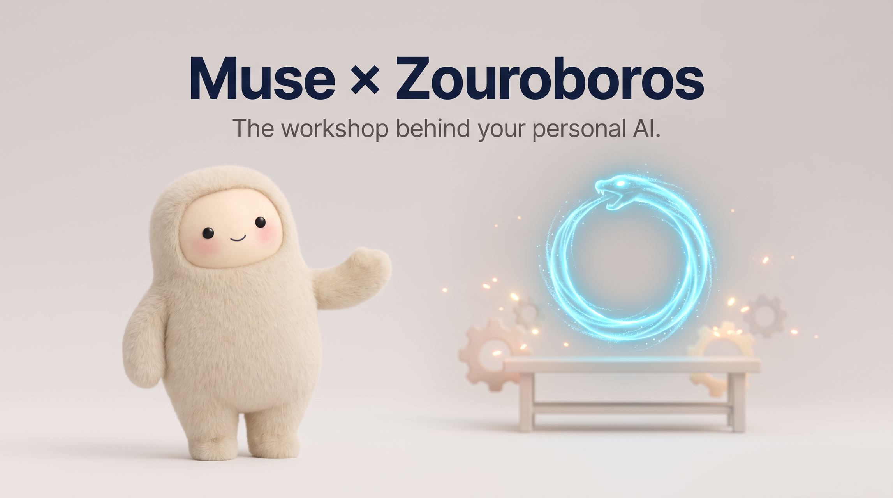
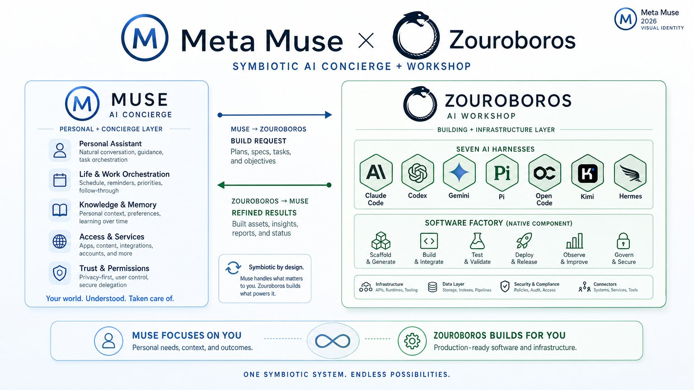

# Zouroboros for Muse

[](LICENSE)
[](package.json)
[](https://www.meta.ai)



**The workshop behind your personal AI.**

Muse is wonderful at being your personal assistant — it chats with you, manages your schedule, remembers who you are, and connects to your apps. But when there's serious building to do, you want a workshop: more than one kind of AI working together, a shared memory of what the work taught, and a process that verifies before it ships. That's Zouroboros. This repo packages it so any Muse user can set it up.

## The big idea

Think of it like a house. **Muse is the front door** — everything about you comes through it: conversation, relationships, scheduling, approvals, your personal memory. **Zouroboros is the workshop out back** — everything about building: running work across several AI tools, remembering what was learned, reviewing code, delivering finished work.

One rule decides where everything goes: *if it's about you, it lives in Muse. If it's about building, it lives in Zouroboros.* Muse calls into the workshop when there's building to do, and the workshop reports back when it's done.



*The big picture: Muse on the left as your personal layer, Zouroboros on the right as the building layer — your AI tools, the build pipeline, and the shared memory underneath. Requests flow one way, finished work flows back.*

## What your Muse can do now

Everything below happens in your normal Muse chat. You don't learn new tools — Muse just gets more capable.

**Build software from a conversation.** Tell Muse what you want built, in plain words. It writes up the job, hands it to the workshop, and comes back with a finished pull request on your repo. Not a code snippet in chat — a real, tested, reviewed PR you can merge. The first time Muse hands you a PR instead of a wall of code, you'll feel the difference.

**Remember everything, across every tool.** Muse stops starting from zero. Decisions you made, things you tried, what worked and what didn't — it's all in a shared memory that Muse, your coding tools, and the workshop all draw from. Ask "what did we decide about the API design?" and get an answer, not a shrug.

**Put your AI subscriptions to work together.** If you pay for coding tools, they're probably sitting idle most of the time. Now when there's real work, Muse spreads it across the ones you have — the right tool for each piece, automatic retries when one stumbles, all inside a budget you set. You paid for them; now they earn it.

**Ship work that's actually checked.** Nothing arrives because an AI *felt* done. Before any PR reaches you, the work is built, tested, and reviewed by specialists — a systems thinker, a testing skeptic, a security eye. They start by watching and reporting; you decide when they've earned the right to hold work back.

**Get smarter the more you build.** Every job teaches the workshop something — which approaches worked, where things broke, what you'd want done differently. That knowledge compounds. Your tenth build goes smoother than your first, because the system remembers what the first nine taught it.

## A day with it

You talk to Muse like always. The difference is what it can say yes to.

> **You:** "Build me a landing page for my side project — dark theme, email signup, mobile-friendly."
>
> **Muse:** "On it — I'll put together the spec and send it to the workshop. I'll check back when the PR is ready."
>
> *(Twenty minutes later.)*
>
> **Muse:** "Done — PR is up. Built, tested, reviewed. Two things the reviewers flagged for you to look at before merging."

Other things you'll find yourself asking:

- *"What did we learn from the last three builds?"* — Muse answers from the shared memory, not from guessing.
- *"Is the workshop healthy?"* — a quick status check, no terminal required.
- *"Remind me why we chose Postgres for this?"* — decisions are recorded, so they stay decided.

Your personal life stays in Muse — your schedule, your messages, your private memory. None of that ever enters the workshop. The bridge carries build requests and status reports, never your credentials.

## Is this for you?

This is for you if you use Muse regularly, you build software (or want AI help building it), and you already pay for one or more AI coding subscriptions. The workshop puts those subscriptions to work together instead of letting each one sit in its own silo.

It's probably not for you yet if you only use Muse for conversation and scheduling — the workshop earns its keep on building work. And it's not a second assistant: if what you want is someone to talk to, that's Muse, and this repo won't change that.

## Hosted Workshop — skip the setup

Don't want to run the infrastructure yourself? The hosted workshop puts the same system on a private VPS, provisioned for you in about 10 minutes — no terminal, no installs, no maintenance.

**[Get a hosted workshop →](https://account.zouroboros.ai)**

- **Your own private VPS** — single-tenant, 8 vCPU / 16 GB RAM, ready for heavy multi-agent builds
- **All 7 executors** — Claude Code, Codex, Gemini, OpenCode, Kimi, Hermes, and Pi, orchestrated as one team
- **Your subscriptions, no second meter** — routes through the Claude/ChatGPT accounts you already pay for
- **Plans:** Free self-hosted tier, or Solo $59/mo, Pro $149/mo, Team $399/mo (annual = 10× monthly)

This repo is the self-hosted path — same software, your hardware, your responsibility. The hosted workshop is the same software, our hardware, our responsibility. Your code and memory export cleanly either way, so you're never locked in.

## How to get started

**Easiest: ask Muse to set you up.** Muse hands you one command, you paste
it into a terminal, then paste the result back — Muse walks you through
the rest in chat:

```bash
curl -fsSL https://raw.githubusercontent.com/marlandoj/muse-zouroboros/main/scripts/quickstart.sh | bash
```

**Short on time but prefer to drive?** Start with
[walkthrough/00-quickstart.md](walkthrough/00-quickstart.md) — install,
prove it's alive, and get your first three wins in about half an hour:
Muse remembering something for you, your first build request from chat,
and a health check at a glance. The one real prerequisite: an AI coding
tool you already pay for, installed and logged in — **or** the free tier
the installer offers (a personal Google account, ~1000 free requests a day,
no credit card). The workshop can only build with tools you have.

**Want the full tour?** Everything is in the walkthrough folder, in order,
written for someone doing this the first time. It starts with what your machine needs, then walks you through each capability one at a time — with a check at the end of every step so you know it worked before moving on. Plan on an afternoon, most of it waiting on installs.

A few things to know going in:

- **You stay in control.** Every hook and every review starts in a mode that only watches. You turn on enforcement after you've read the reports and trust what you see.
- **It degrades gracefully.** Missing pieces don't break the whole thing — they get skipped with a note. Two AI tools is enough to start; you don't need all of them.
- **Your keys stay yours.** API keys live in a private file on your machine that only you can read. They never go into chat, never into the repo, never across the bridge to Muse.
- **Start small.** The walkthrough has you prove each piece with something tiny before trusting it with real work. That caution is the entire philosophy.

## Honest notes

This is a working system extracted from a live setup, not a polished product. Some edges are rough, and the walkthrough marks every known one. The deeper automation exists but ships turned off — the chat-driven path is the one to use. The reviewers watch and report but don't block anything yet. These are deliberate choices: observation before enforcement, everywhere.

## Questions people ask

**Will this replace my Muse?**
No. Muse stays exactly what it is — your assistant, your front door. The workshop only does building work when Muse hands it over. If you never build software with AI, you'll never notice it's there.

**Do I need to pay for anything extra?**
To start, one thing: an OpenAI API key, which powers the memory's understanding (and there's a free fallback mode without it). The swarm itself runs on AI coding subscriptions you already pay for — that's the point. It puts them to work together instead of letting each one sit idle. The full breakdown — which keys exist, how to get each one, what they cost, and how to tell they're working — is in docs/api-keys.md.

**What if I only have one AI coding tool installed?**
Two is the practical minimum, so that when one fails or is slow, there's somewhere else for the work to go. You don't need all seven — install the ones you actually use.

**Does my data leave my machine?**
Only to the AI services you choose to use. Your memory, your builds, and your history all live on your machine. The system is designed so a broken or missing piece gets skipped with a clear note — never silently, and never taking the rest down with it.

**I'm not very technical. Can I still set this up?**
The walkthrough was written for exactly that person. It goes step by step, tells you what each piece does in plain terms, and every step ends with a check so you know it worked before moving on. If a step confuses you, ask your Muse — that's what it's for.

**What if something breaks?**
There's a health check that looks at every part of the system and tells you — in plain language — which part is unhappy and where to look. And the rule throughout is graceful: a broken piece gets skipped with a note, never silently, and never takes the rest down with it.

## License

MIT. See LICENSE. The hooks build on fine open-source work that's credited in their own folders.

---

*If this earns a place in your workflow, a ⭐ helps others find it. Questions and ideas welcome in [Issues](https://github.com/marlandoj/muse-zouroboros/issues) — and if you build something with it, we'd love to hear about it.*
