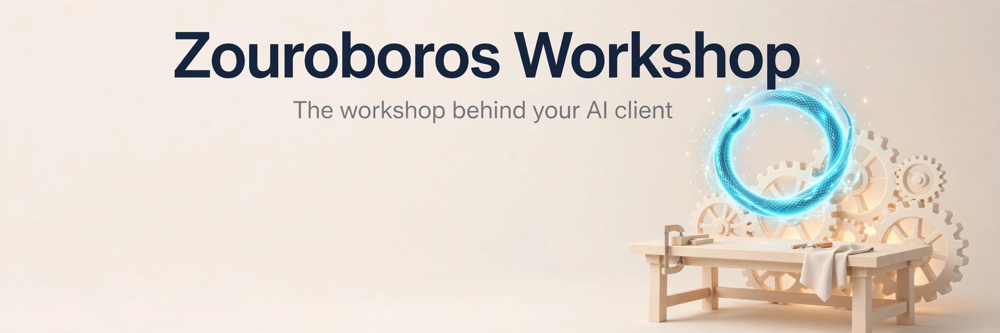
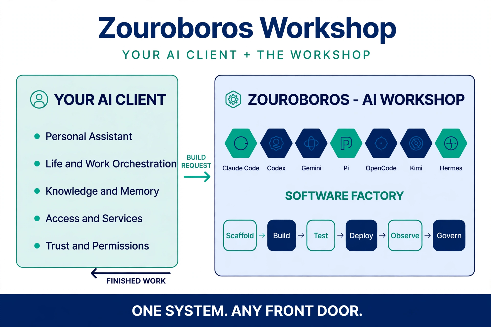

# Zouroboros Workshop

[](LICENSE)
[](package.json)
[](docs/connect.md)



**The workshop behind your personal AI.**

Your AI assistant is wonderful at being your assistant — it chats with you, keeps track of what matters to you, and connects to your apps. But when there's serious building to do, you want a workshop: more than one kind of AI working together, a shared memory of what the work taught, and a process that verifies before it ships. That's Zouroboros. This repo packages it so you can run it yourself and connect it to the AI client you already use.

## The big idea

Think of it like a house. **Your AI client is the front door** — everything about you comes through it: conversation, relationships, scheduling, approvals, your personal memory. **Zouroboros is the workshop out back** — everything about building: running work across several AI tools, remembering what was learned, reviewing code, delivering finished work.

One rule decides where everything goes: *if it's about you, it lives in your AI client. If it's about building, it lives in Zouroboros.* Your client calls into the workshop when there's building to do, and the workshop reports back when it's done.



*The big picture: your AI client on the left as your personal layer, Zouroboros on the right as the building layer — your AI tools, the build pipeline, and the shared work memory underneath. Requests flow one way, finished work flows back. Your client's own personal memory and the workshop's work memory are separate: there is no sync between them.*

## What your AI client can do once it's connected

Everything below happens in your normal chat with your assistant, once it is connected to the workshop ([how to connect](docs/connect.md)). You don't learn new tools — your assistant just gets more capable.

**Build software from a conversation.** Describe what you want built, in plain words. The workshop's factory lane turns that job into a finished pull request on your repo. Not a code snippet in chat — a real, tested, reviewed PR you can merge. One honest seam: in the Community Edition the job enters the lane as a **Linear issue labelled `factory-ready`** in your Linear Intake project. No Community MCP tool files that ticket, so your assistant can file it only if it also has Linear access (a Linear connector or Linear MCP); otherwise you file it in Linear yourself. Details in [docs/connect.md — the seams](docs/connect.md#what-the-connections-cannot-do-the-seams).

**Remember everything, across every tool.** Your assistant stops starting from zero. Decisions you made, things you tried, what worked and what didn't — it's all in a shared work memory that your AI client, your coding tools, and the workshop all draw from. Ask "what did we decide about the API design?" and get an answer, not a shrug.

**Put your AI subscriptions to work together.** If you pay for coding tools, they're probably sitting idle most of the time. Now when there's real work, the workshop spreads it across the ones you have — the right tool for each piece, automatic retries when one stumbles, all inside a budget you set. Your assistant only has to ask. You paid for them; now they earn it.

**Ship work that's actually checked.** Nothing arrives because an AI *felt* done. Before any PR reaches you, the work is built, tested, and reviewed by specialists — a systems thinker, a testing skeptic, a security eye. They start by watching and reporting; you decide when they've earned the right to hold work back.

**Get smarter the more you build.** Every job teaches the workshop something — which approaches worked, where things broke, what you'd want done differently. That knowledge compounds. Your tenth build goes smoother than your first, because the system remembers what the first nine taught it.

## A day with it

You talk to your assistant like always. The difference is what it can say yes to.

> **You:** "Build me a landing page for my side project — dark theme, email signup, mobile-friendly."
>
> **Your assistant:** "On it — I'll write up the ticket and file it in your factory intake. I'll check back when the PR is ready."
>
> *(Twenty minutes later.)*
>
> **Your assistant:** "Done — PR is up. Built, tested, reviewed. Two things the reviewers flagged for you to look at before merging."

Other things you'll find yourself asking:

- *"What did we learn from the last three builds?"* — your assistant answers from the shared work memory, not from guessing.
- *"Is the workshop healthy?"* — a quick status check, no terminal required (for clients that can run a command on the install machine; see the seams in [docs/connect.md](docs/connect.md)).
- *"Remind me why we chose Postgres for this?"* — decisions are recorded, so they stay decided.

Your personal life stays in your AI client — your schedule, your messages, your private memory. None of that ever enters the workshop. The bridge carries build requests and status reports, never your credentials.

## Is this for you?

This is for you if you build software (or want AI help building it), you use an AI client that can connect to an MCP server — a terminal agent, a desktop app, an editor, or a web chat — and you already pay for one or more AI coding subscriptions. The workshop puts those subscriptions to work together instead of letting each one sit in its own silo.

It's probably not for you yet if you only use your assistant for conversation and scheduling — the workshop earns its keep on building work. And it's not a second assistant: if what you want is someone to talk to, that's your AI client, and this repo won't change that.

## Hosted Workshop — skip the setup

Don't want to run the infrastructure yourself? The hosted workshop puts the same system on a private VPS, provisioned for you in about 10 minutes — no terminal, no installs, no maintenance.

**[Get a hosted workshop →](https://account.zouroboros.ai)**

- **Your own private VPS** — single-tenant, 8 vCPU / 16 GB RAM, ready for heavy multi-agent builds
- **All 7 executors** — Claude Code, Codex, Gemini, OpenCode, Kimi, Hermes, and Pi, orchestrated as one team
- **Your subscriptions, no second meter** — routes through the Claude/ChatGPT accounts you already pay for
- **Plans:** Free self-hosted tier, or Solo $59/mo, Pro $149/mo, Team $399/mo (annual = 10× monthly)

This repo is the self-hosted path — same software, your hardware, your responsibility. The hosted workshop is the same software, our hardware, our responsibility. Your code and memory export cleanly either way, so you're never locked in.

## Two editions

**Community Edition** — this repository. Open source (MIT), self-hosted, and free forever: the memory system, all 7 executors, the swarm orchestrator, Verity verification, and the factory lane. Your AI client connects to two local MCP servers (memory and swarm), or, for web clients, to an opt-in OAuth remote endpoint you run yourself. Maintained with security and install fixes.

**Hosted Workshop** — the operated platform: your own dedicated VPS, the full 46-tool MCP server, compounding memory with provenance, and audit-logged export — and we run the infrastructure for you, with email support.

## What you get: the MCP tools

### Community Edition (this repository)

Two stdio MCP servers that run on the machine where you install the workshop — 11 tools in all. Every client you connect gets both ([docs/connect.md](docs/connect.md)).

- **Memory** (`zouroboros-memory`) — `memory_search`: search everything the workshop remembers; `memory_store`: save a fact or decision; `memory_episodes`: recall past work sessions; `memory_procedures`: how-to knowledge that accumulates; `cognitive_profile`: the workshop's model of how you work; `memory_session_observations`: dated per-session digests of past work, with evidence links.
- **Swarm** (`zouroboros-swarm`) — `swarm_execute`: run a campaign of tasks across your local coding agents; `swarm_status`: check running work; `swarm_results`: collect finished work; `swarm_benchmark`: compare swarm memory strategies; `swarm_list`: list recent campaign runs.

Web clients reach the same tools through remote mode (`packages/workshop-remote`): one HTTPS MCP endpoint behind OAuth 2.1 with PKCE, off by default. It serves the memory tools, and the swarm tools only if you opt in.

The Community Edition has no in-product guide tool (`workshop_guide`), no onboarding tracker, and no tool that files factory tickets: its in-product guidance is the installer's handoff block and the concierge playbook ([docs/concierge.md](docs/concierge.md)).

### Hosted Workshop adds

A hosted workshop is one MCP server your AI client connects to with a single sign-in. Everything below is a tool your client can call — 46 in all.

- **Memory** — `memory_search`: search everything the workshop remembers; `memory_store`: save a fact or decision; `memory_episodes`: recall past work sessions; `memory_procedures`: how-to knowledge that accumulates; `cognitive_profile`: the workshop's model of how you work.
- **Swarm** — `swarm_dispatch`: hand a task to the AI build team (Claude Code, Codex, Gemini, and more, routed automatically); `swarm_status`: check running work; `swarm_results`: collect finished work; `swarm_artifacts`: fetch a finished campaign's artifacts; `swarm_cancel`: stop a running campaign; `swarm_workspace_files`: download a campaign workspace as one archive, or upload a file into it, even while it runs; `swarm_executors`: see the team roster and health; `swarm_doctor`: diagnose the team.
- **Factory** — `factory_run`: run the spec-to-build-to-verified lane; `factory_smoke`: quick end-to-end check; `factory_status`: lane status; `factory_queue`: every task bundle shipped to the factory — title, state (queued/running/done/failed), ship and finish times.
- **Workshop** — `workshop_guide`: how to use the workshop; `onboarding_status`: setup progress; `workshop_update`: pull the latest release; `workshop_capabilities`: what this workshop can do; `workshop_whoami`: which workshop and account you're connected as.
- **Make it yours** — `workshop_add_executor`: connect another AI subscription; `workshop_install_executor`: install an executor program; `workshop_signin_executor`: sign an installed executor in; `workshop_set_model`: choose models per executor; `workshop_add_skill`: adopt a new skill (security-scanned first); `workshop_add_mcp`: adopt another MCP server (probed and classified first); `workshop_remove_adopted`: remove an adopted skill or MCP server.
- **Manage** — `workshop_memory_config`: memory retention and forgetting controls; `workshop_schedule`: recurring jobs on timers; `workshop_team`: seats and invites; `workshop_model_health`: model health evidence, including flagged or stalling models, and the owner's decisions on them; `workshop_keys`: manage the workshop's keys; `workshop_add_provider`: connect a custom model provider.
- **Library** — `workshop_library_list`: what's in your library; `workshop_library_add`: add a book (a document collection) to it; `workshop_library_refresh`: re-index a book; `workshop_library_remove`: remove a book; `workshop_library_search`: search across the library.
- **Live views** — `workshop_status`: the whole workshop in one call — VPS service states, executor roster, swarm activity, memory stats; `bridge_inbox_list`: task bundles waiting in the factory-dispatch bridge inbox (read-only).
- **API & data** — `workshop_api_key`: mint API keys for automation; `workshop_export`: export everything — repo, memory, configs (secrets redacted) — as a tarball or GitHub branch; password re-auth required. No lock-in; `client_capabilities_register`: tell the workshop what the connected client can do; `client_capabilities_query`: read back what a client registered.

**Prefer API access?** Create an API key in chat (shown once; only a hash is stored) and call the same MCP endpoint with a Bearer key from scripts, cron jobs, or other agent orchestrators — no browser login needed. OAuth 2.0 with PKCE remains the standard interactive sign-in for MCP clients.

## How to get started

Two steps: install the workshop, then connect your AI client to it.

### 1. Install

The command needs nothing but `bash` and `curl`:

```bash
curl -fsSL https://raw.githubusercontent.com/marlandoj/zouroboros-workshop/main/scripts/quickstart.sh | bash
```

Before it touches git or disk, the installer checks the workshop's
prerequisites — Bun, Node 22+, Python 3.11+, `git`, `jq` and `timeout`
(GNU coreutils), plus `unzip` when Bun is missing, since the Bun installer
needs it — [full list](walkthrough/01-prerequisites.md). If any are
missing or too old, it stops and prints the exact commands that install
them on your Linux distro, system packages first. It never installs them
itself and never uses `sudo`: you run the commands, then run the installer
again.

(Already have Node? `npx -y muse-zouroboros@latest` runs the same
installer. npx needs Node and npm installed first, so on a fresh machine
use the curl form.)

When it finishes, the installer prints a **handoff block**: what's green,
what's red, and what to do next.

### 2. Connect your AI client

The connect guide, **[docs/connect.md](docs/connect.md)**, has one tested
path per client: the exact config (print it with your machine's paths filled
in by `bash scripts/connect-config.sh <client>`), where the concierge
playbook goes in that client, and the first check to run.

| Client | How it connects | What was tested (2026-11-25) |
|---|---|---|
| Codex CLI, Claude Code, Gemini CLI, OpenCode, Hermes Agent, Kimi Code, Pi | local config, both stdio servers | end to end: the client's own config and MCP connection, 11 tools, a memory round trip made by the client |
| Claude Desktop, Cursor, VS Code (Copilot agent mode) | local config file | the config file at the app's real path, driven by a scripted MCP client; the app UI itself not yet |
| Muse (our reference integration), ChatGPT, Claude.ai | web clients, over the opt-in OAuth remote endpoint (`packages/workshop-remote`) | the protocol, with scripted clients over public HTTPS: discovery, registration, PKCE sign-in, token, a real tool call. Registering the connector inside each app is documented step by step but not yet verified in the apps |

**Then let your assistant guide you.** With the playbook loaded, paste the
installer's handoff block into the client you connected. It reads what's
green and red, walks you through anything that needs attention, and guides
you to your first three wins in chat.

**Short on time but prefer to drive?** Start with
[walkthrough/00-quickstart.md](walkthrough/00-quickstart.md) — install,
prove it's alive, and get your first three wins in about half an hour:
your AI client remembering something for you, your first factory ticket,
and a health check at a glance. Beyond Bun and the runtimes above, the one real prerequisite: an AI coding
tool you already pay for, installed and logged in — **or** the free tier
the installer offers (a personal Google account, ~1000 free requests a day,
no credit card). The workshop can only build with tools you have.

**Want the full tour?** Everything is in the walkthrough folder, in order,
written for someone doing this the first time. It starts with what your machine needs, then walks you through each capability one at a time — with a check at the end of every step so you know it worked before moving on. Plan on an afternoon, most of it waiting on installs.

A few things to know going in:

- **You stay in control.** Every hook and every review starts in a mode that only watches. You turn on enforcement after you've read the reports and trust what you see.
- **It degrades gracefully.** Missing pieces don't break the whole thing — they get skipped with a note. One healthy AI coding tool is enough to start; you don't need all of them.
- **Your keys stay yours.** API keys live in a private file on your machine that only you can read. They never go into chat, never into the repo, never across the bridge to your AI client.
- **Start small.** The walkthrough has you prove each piece with something tiny before trusting it with real work. That caution is the entire philosophy.

## Honest notes

This is a working system extracted from a live setup, not a polished product. Some edges are rough, and the walkthrough marks every known one. The deeper automation exists but ships turned off — the chat-driven path, through an AI client you've connected ([docs/connect.md](docs/connect.md)), is the one to use. The reviewers watch and report but don't block anything yet. These are deliberate choices: observation before enforcement, everywhere. The live setup's Command Center web UI was deliberately left out of this package.

## Questions people ask

**Will this replace my AI assistant?**
No. Your assistant stays exactly what it is — your assistant, your front door. The workshop only does building work when your assistant hands it over. If you never build software with AI, you'll never notice it's there.

**Which AI clients can I use?**
Any client that can connect to an MCP server. Local clients (terminal agents, desktop apps, editors) start the workshop's servers themselves; web clients connect over the opt-in remote endpoint. The per-client steps, and exactly what has been tested for each, are in [docs/connect.md](docs/connect.md).

**Do I need to pay for anything extra?**
Nothing to start: no API key is required, and memory runs keyword-only without one. An OpenAI API key is an optional upgrade that powers the memory's semantic search. The swarm itself runs on AI coding subscriptions you already pay for — that's the point. It puts them to work together instead of letting each one sit idle. The full breakdown — which keys exist, how to get each one, what they cost, and how to tell they're working — is in docs/api-keys.md.

**What if I only have one AI coding tool installed?**
One healthy tool is enough to start — the swarm routes around the rest. Two is better, so that when one fails or is slow, there's somewhere else for the work to go. You don't need all seven — install the ones you actually use.

**Does my data leave my machine?**
Only to the AI services you choose to use. Your memory, your builds, and your history all live on your machine. The system is designed so a broken or missing piece gets skipped with a clear note — never silently, and never taking the rest down with it.

**I'm not very technical. Can I still set this up?**
The walkthrough was written for exactly that person. It goes step by step, tells you what each piece does in plain terms, and every step ends with a check so you know it worked before moving on. If a step confuses you, ask your AI assistant — that's what it's for.

**What if something breaks?**
There's a health check that looks at every part of the system and tells you — in plain language — which part is unhappy and where to look. And the rule throughout is graceful: a broken piece gets skipped with a note, never silently, and never takes the rest down with it.

## License

MIT. See LICENSE. The hooks build on fine open-source work that's credited in their own folders.

---

*If this earns a place in your workflow, a ⭐ helps others find it. Questions and ideas welcome in [Issues](https://github.com/marlandoj/zouroboros-workshop/issues) — and if you build something with it, we'd love to hear about it.*
