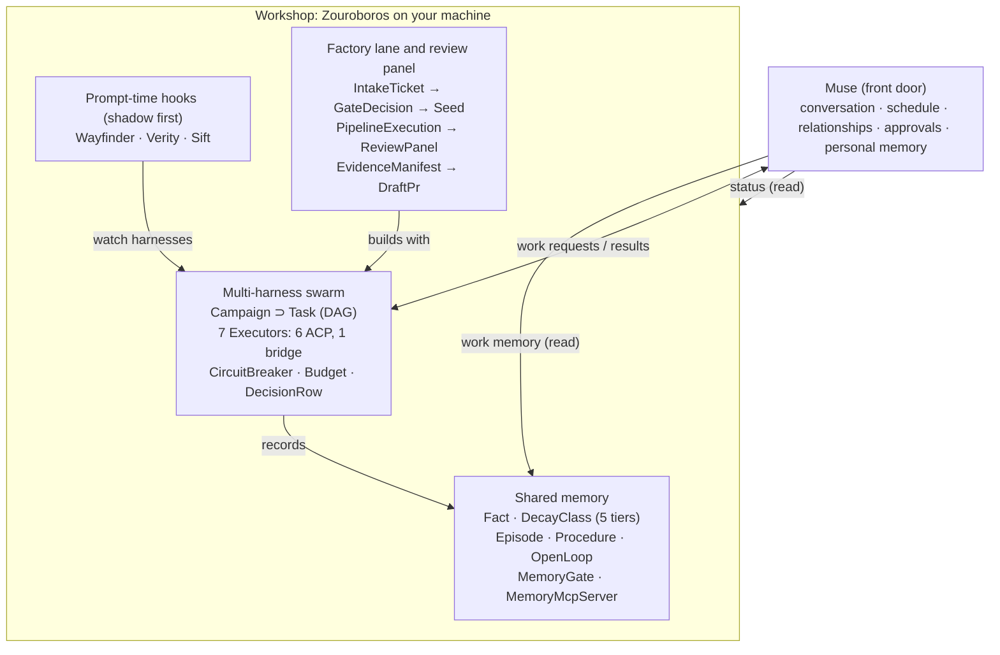

# Muse × Zouroboros Ontology

_As of 2026-10-11 · derived from `marlandoj/muse-zouroboros @ 22a82c4` · class names and axioms cite the files that enforce them._

## Purpose and scope

This ontology names the things that exist in [marlandoj/muse-zouroboros](https://github.com/marlandoj/muse-zouroboros) (commit `22a82c4`), how they relate, and the rules the code enforces between them. It is derived from the repo's README, `docs/`, `walkthrough/`, the seven packages under `packages/`, and the factory lane under `factory/lane/`.

The repo packages Zouroboros as a **workshop** for users of **Muse**, a personal assistant. One rule splits the world in two: anything about the user (conversation, schedule, relationships, personal memory, approvals) lives in Muse; anything about building (swarm work, work memory, review, delivery) lives in Zouroboros. Muse reaches the workshop only through narrow bridges that carry work requests and status, never personal data or credentials.

Conventions used throughout:

- **Classes** are `PascalCase`; subclasses are written `Child ⊑ Parent`.
- **Relations** are `camelCase` verbs read left to right (`Ticket enters Lane`).
- **Axioms** are numbered `A1…An` and each cites the file that enforces it.
- **Evidence** columns point at repo paths so every term traces back to source.

## Class hierarchy

The top split is `Muse` versus `Workshop`; inside the workshop, every class belongs to one of four domains. The factory builds with the swarm, the swarm records into shared memory, and the hooks watch the harnesses the swarm drives.



The dispatch bridge is the only two-way link: work requests go in, and finished draft pull requests come back to Muse.

## Muse boundary and bridges

Muse and the workshop share no personal state; three bridges carry status, work memory and work requests in one direction each. Credentials never cross any bridge.

| Class | Definition | Key attributes | Realized in |
| --- | --- | --- | --- |
| `Muse` | The user's personal assistant and front door: conversation, schedule, relationships, approvals, personal memory | outside this repo; never writes into the shared work memory | `README.md`, `docs/architecture.md` |
| `Workshop` | Zouroboros as packaged here: memory, swarm, hooks, factory, review panel | runs on the user's machine | `README.md` |
| `Bridge` | A narrow connector from Muse into the workshop | carries status and work requests only | `docs/architecture.md` |
| `StatusBridge ⊑ Bridge` | Read-only health check Muse can run | sections `memory`, `executors`, `orchestrator`, `factory`, `hooks`; text or `--json` | `examples/workshop-status.sh` |
| `MemoryReadBridge ⊑ Bridge` | One-way read of the shared work memory | via CLI or the `zo-memory-system` MCP server | `docs/architecture.md` |
| `DispatchBridge ⊑ Bridge` | Hands building work to the workshop | swarm MCP tools, or a factory ticket using the five-field contract | `docs/architecture.md` |
| `WorkshopEnv` | The private file holding API keys | `~/.config/zouroboros/workshop.env`, mode 0600 | `scripts/bootstrap.sh`, `docs/security.md` |
| `VerificationScript` | One command that probes every system and names the unhappy one | memory, executor doctor, orchestrator doctor, hooks, factory smoke, `OPENAI_API_KEY` | `scripts/verify.sh` |

## Shared memory

One SQLite database, `~/.zo/memory/shared-facts.db`, is the well that Claude Code, Codex and Muse all draw from. Its atomic unit is a `Fact` with a five-step decay class; without an OpenAI key it falls back to full-text search.

| Class | Definition | Key attributes | Realized in |
| --- | --- | --- | --- |
| `Fact` | An entity/key/value statement (`facts`) | `persona` (default `shared`), `category`, `decay_class` (default `stable`), `importance`, `confidence`, `expires_at` | `packages/zo-memory-system/scripts/schema.sql` |
| `DecayClass` | How long a fact lives and how fast it fades | `permanent` (no TTL), `stable` 90 d, `active` 14 d, `session` 24 h, `checkpoint` 4 h | `schema.sql` (`ttl_defaults`), `unified-decay.ts` |
| `FactEmbedding` | Vector for semantic search | `model` default `text-embedding-3-small` | `schema.sql` |
| `FactLink` | Typed, weighted edge between facts | `relation` (`depends_on`, `supersedes`, `caused_by`, `part_of`, `implements`, `blocks`, `related_to`), `weight` | `schema.sql`, `graph-traversal.ts` |
| `Episode` | Something that happened, with an outcome | `outcome` (`success`, `failure`, `resolved`, `ongoing`), `procedure_id` | `schema.sql` |
| `Procedure` | Versioned reusable workflow | `steps`, `success_count`, `failure_count`, `evolved_from` | `schema.sql` |
| `OpenLoop` | Unfinished work carried forward | `kind` (`task`, `bug`, `incident`, `approval`, `commitment`, `other`), `status` (`open`, `resolved`, `stale`, `superseded`), `fingerprint` | `schema.sql` |
| `FactConflict` | A contradiction between two facts | `resolution` (`superseded`, `merged`, `flagged`, `pending`) | `conflict-resolver.ts` |
| `SourceChunk` / `Topic` | Cited source text and topical grouping of facts | `chunk_md5`, `cited_text`; `slug`, `fact_count` | `schema.sql` |
| `CaptureLog` | Record of one transcript-to-facts extraction | `facts_extracted`, `facts_skipped`, `contradictions`, `model` | `schema.sql` |
| `MemoryGate` | Decides at prompt time whether background memory is needed | exit 0 found, 2 not needed, 3 needed but missing, 1 error; methods include `continuation`, `keyword_heuristic`, `llm_classifier` | `memory-gate.ts` |
| `MemoryMcpServer` | stdio server `zo-memory-system` v3.2.0 | tools `memory_search`, `memory_store` (both REQUIRE `actor`; fail closed with `MISSING_ACTOR`), `memory_episodes`, `memory_procedures`, `cognitive_profile`; HTTP variant adds `memory_delete`, `memory_prune` (also actor-required) | `mcp-server.ts` |
| `Scope` | Actor-resolved visibility (own persona + shared pool); the single choke point for every persona predicate | `actor`, `personas`; `MISSING_ACTOR` on absent identity | `scope.ts` |
| `MemoryAudit` | One row per scoped memory access | `actor`, `scope`, `action` (`store`, `search`, `search_vector`, `get`, `delete`, `forget`, `restore`, `purge`, `promotion_stage`, `review_decision`), `call_id` | `scope.ts` |
| `FactPromotion` | Append-only promotion ledger; a fact's stage is its latest row | `stage` (`capture`, `extraction`, `review`, `promotion`), `decided_by`, `contradiction_of` | `promotion.ts` |
| `FactForgotten` | Reversible-forgetting marker hiding a fact from all retrieval | `forgotten_by`, `reason`, `retention_score`; removal = restore; hard delete only via retention-window purge | `forgetting.ts` |

## Multi-harness swarm

The swarm spreads a campaign's tasks across seven AI coding harnesses the user already pays for, routes each task by weighted signals, and records every dispatch in a hash-chained ledger. Two installed harnesses is the practical minimum.

| Class | Definition | Key attributes | Realized in |
| --- | --- | --- | --- |
| `Campaign` | A set of tasks run together (`SwarmCampaign`); on disk a bare task array | `status` (`pending`, `running`, `completed`, `failed`), `config` | `zo-swarm-orchestrator/src/types.ts`, `campaigns/*.json` |
| `Task` | One unit of work | `priority` (`critical`, `high`, `medium`, `low`), `dependsOn[]`, `executor`, `fallbackExecutors[]`, `memoryStrategy`, `timeoutSeconds` | `src/types.ts` |
| `SwarmConfig` | Run settings | `localConcurrency` 8, `timeoutSeconds` 600, `maxRetries` 3, `dagMode` (`streaming`, `waves`), `pipelineGates` | `config.json`, `src/types.ts` |
| `Executor` | A registered harness | `claude-code`, `hermes`, `gemini`, `codex`, `opencode`, `kimi` (ACP); `pi` (bridge) | `zo-swarm-executors/registry/executor-registry.json` |
| `Service` | A non-executor DAG node in the registry | `mimir` (memory context, health on port 7820) | `executor-registry.json` |
| `Transport` | How an executor is reached | `acp` (persistent session) or `bridge` (one-shot script in `bridges/*-bridge.sh`) | `zo-swarm-executors/` |
| `Role` | A job seeded onto an executor with SOP fields | `senior-architect` → claude-code, `backend-developer` → codex, `ui-developer` → gemini, `researcher` → hermes, and three more | `src/db/schema.ts` (`swarm_roles`) |
| `RouteDecision` | The chosen executor for a task | `compositeScore`, `breakdown`, `method` (`composite`, `fallback`) | `src/routing/engine.ts` |
| `RoutingSignal` | One scored routing input | six: `capability`, `health`, `complexityFit`, `history`, `procedure`, `temporal`; eight adds `budget`, `role` | `src/routing/engine.ts` |
| `SwarmDecisionGate` | Decides whether a request warrants a swarm | `SWARM` (score above 0.45), `SUGGEST` (0.30 to 0.45), `DIRECT` (below 0.30) | `src/routing/swarm-decision-gate.ts` |
| `CircuitBreaker` | Per-executor health | `CLOSED`, `OPEN`, `HALF_OPEN`; 30 s base cooldown doubling to a 300 s cap | `src/circuit/breaker.ts` |
| `Budget` | Spend envelope for a swarm | `total_budget_usd`, alert at 80 %, `hard_cap_action` (`pause`, `abort`, `downgrade`; default `downgrade`) | `src/budget/governor.ts` |
| `DecisionRow` | Hash-chained JSONL record of one dispatch or review seat | `traceId`, `personaId`, `harness`, `modelId`, `status`, `prevHash`, `hash` | `src/ledger/decision-ledger.ts` |
| `SwarmMcpServer` | `zo-swarm-orchestrator` v4.6.0 over stdio and HTTP (port 48401) | `swarm_execute`, `swarm_status`, `swarm_results`, `swarm_benchmark`, `swarm_list` | `mcp-server.ts`, `mcp-server-http.ts` |

## Prompt-time hooks

Three guardians watch the harnesses as they work, and each starts in `shadow` mode: observe and log, never act. Each hook is a `Hook ⊑ Guardian` bound to harness events.

| Class | Definition | Watches | Modes and outputs | Realized in |
| --- | --- | --- | --- | --- |
| `Wayfinder ⊑ Hook` | Suggests the right skill for a prompt | prompt submit: `UserPromptSubmit` (claude, codex, kimi), `BeforeAgent` (gemini), `chat.message` (opencode), `before_agent_start` (pi), `pre_llm_call` (hermes) | `shadow` (default), `live`, `off`; logs `prompt_sha256` to `~/.wayfinder/suggestions.jsonl` | `packages/wayfinder` |
| `Verity ⊑ Hook` | Refuses to let an agent declare victory when tests have not passed since the last edit; model-free | every harness event, analyzed by pinned Canny | `shadow` (default), `live`, `off`; verdict kinds `done`, `deny`, `ask`, `rewrite`, `note`, `warn`, `none` | `packages/verity` |
| `Sift ⊑ Hook` | Trims repeated tool output so long sessions keep their context | tool calls and results | `shadow` (default), `live` (opencode, pi, hermes only), `off`; prune reasons `exact_duplicate_read`, `explicitly_successful_check` | `packages/sift` |
| `HookLedger` | Per-hook append log of what the hook saw or would have done | records fingerprints and byte counts, never prompt text | `~/.wayfinder`, `~/.verity`, `~/.sift` | `docs/hooks.md` |

## Software factory lane

The factory turns a ticket into a draft pull request through ten stages, and nothing ships because an agent felt done: it ships because named checks passed. The ticket-driven "Conveyor" path is live; the event-driven "Native Loops" path ships off.

| Class | Definition | Key attributes | Realized in |
| --- | --- | --- | --- |
| `IntakeTicket` | A work request pulled from the intake project by its `factory-ready` label | `identifier`, `title`, `description`, `state`, `labels[]` | `factory/lane/scripts/linear-puller.ts`, `ticket-contract.ts` |
| `TicketContract` | The five fields every ticket must carry | `title`, `acceptance_criteria`, `target_repo`, `archetype`, `repro` | `ticket-contract.ts` |
| `Archetype` | The kind of change, which sets gates and limits | `bugfix`, `dependency`, `docs`, `feature`, `refactor`, `migration` | `line-config.json` |
| `LineConfig` | Per-archetype policy | `mandatory_gates`, `max_rung`, `auto_merge_eligible`, `risk_posture` (`aggressive`, `standard`, `conservative`) | `line-config.json` |
| `GateDecision` | The dispatcher's routing verdict for a ticket | `DIRECT`, `SWARM`, `FORCE_SWARM`, `SUGGEST`, `ERROR` | `scripts/dispatcher.ts` |
| `Seed` | Frozen goal, constraints, acceptance criteria, task DAG and exit conditions for a swarm ticket | `goal`, `constraints[]`, `acceptance_criteria[]`, `tasks[]`, `exit_conditions[]` | `seed-*.yaml`, `pool-queue.ts` |
| `PipelineExecution` | One run of the lane for one ticket, saved as `state/exec-<id>.json` | `stage`, `status`, `branch_name`, `commit_digest`, `pr_number`, `model_cost_usd`, `shadow_phase` | `scripts/swarm-exec.ts` |
| `ExecutionState` | Lifecycle of an execution | `executing`, `implementation_complete`, `verified`, `pr_ready`, `ci_green`, `merged`, `deployed`, `accepted`, `failed`, `held`, `dry_run`, `pool_enqueued` | `execution-lifecycle.ts` |
| `HoldRecord` | Why an execution is paused for the operator | `reason` (`approval_gate`, `slo_gate`, `failure_streak`, `diversity_of_thought_review`, …), `released_by` | `swarm-exec.ts` |
| `ShadowPhase` | How far the lane has been trusted | `idle`, `dry-run` (48 h min), `shadow-pr` (96 h min), `live` | `shadow-state.ts` |
| `Rung` | Permission ladder for what the lane may touch | `read-only`, `branch-write`, `open-pr`, `staging`, `production` | `line-config.json` |
| `WorkItem` / `PoolCampaign` | Queue units for the worker pool | item `ready`, `in-flight`, `done`, `failed`, `parked`; campaign cost ceiling $5 | `pool-queue.ts` |
| `EvidenceManifest` | Hash-sealed record of what proves an execution | `commit_digest`, `seed_hash`, `reviewers[]`, `test_evidence`, `supply_chain`, `content_hash` | `factory-evidence.ts` |
| `FactoryVerdict` | Final pass or fail citing the evidence hash | `verdict`, `rework`, `evidence_manifest_hash` | `factory-verdict.ts` |
| `DraftPr` | The lane's only delivery form | `draft: true`, `auto_merge: false` | `draft-pr.ts`, `ship-ready-core.ts` |
| `RunReceipt` / `AuthorityEnvelope` | Contract schemas for durable run evidence and scoped authority | receipt `terminal` (`success`, `failure`, `partial`, `timeout`, `cancelled`, `held`); envelope `capabilities`, `global_rung_cap` | `factory/lane/contracts/` (contract only, no production writer) |
| `RuntimeFlags` | Typed feature switches for the lane | schema v9; unknown keys and secret-like names rejected; template ships all off | `config/runtime-flags.json`, `runtime-config.ts` |

The stages in order are pull, completeness check, health gate, route, build with swarm, supply-chain preflight, review gate, evidence and gap review, draft PR, and writeback.

## Review panel

Specialist personas review finished work before it becomes a pull request. The panel replaced the retired multi-model consensus gate; it can hold work back, but it has no path to approve a merge.

| Class | Definition | Key attributes | Realized in |
| --- | --- | --- | --- |
| `ReviewPanel` | The set of personas seated for one review | always `zouroboros-review` and `reality-check`; adds `ai-review` on AI/model keywords and `security-review` on high risk or security keywords | `factory/lane/scripts/factory-diversity-review.ts` |
| `ReviewPersona` | One seated reviewer | Zouroboros Engineer, Testing Reality Checker, AI Engineer, Security Engineer | `factory-diversity-review.ts` |
| `PersonaInvocation` | Evidence that one persona actually reviewed | `status` (`invoked`, `would_invoke`, `omitted`, `blocked`, `not_invoked`), `verdict` (`pass`, `fail`), `distinct_model`, `vendor_diverse`, `cost_usd` | `persona-orchestrator.ts` |
| `FactoryReviewResult` | The panel's record for one execution, `review-<id>.json` | `mode` (`shadow`, `enforce`), `review_level` (`deterministic`, `diversity`), `diversity_terminal_state` (`pass`, `pass_with_dissent`, `hold`, `shadow`, `no_review`), `blocking`, `advance_to_verified` | `factory-review-gate.ts` |
| `RiskTier` | How risky a ticket is judged | `low`, `medium`, `high` | `factory/lane/scripts/` |
| `ConsensusGate` (retired) | Former multi-model verdict gate, kept for audit | `passed`, `rejected`, `escalate`; weighted pass at 0.75 or above | `packages/consensus-gate` |
| `PanelReport` | Read-only summary of past panel verdicts | reads `mode`, `persona_reviews`, `blocking`, `pass` | `scripts/panel-report.sh` |

## Relations

These object properties connect the classes above; cardinality is what the code enforces.

| Domain | Property | Range | Cardinality | Evidence |
| --- | --- | --- | --- | --- |
| `Muse` | `readsStatusVia` | `StatusBridge` | 0..1 | `examples/workshop-status.sh` |
| `Muse` | `readsMemoryVia` | `MemoryReadBridge` | 0..1, read-only | `docs/architecture.md` |
| `Muse` | `dispatchesVia` | `DispatchBridge` | 0..1 | `docs/architecture.md` |
| `Bridge` | `carries` | status or work request | never credentials or personal facts | `docs/security.md` |
| `Fact` | `hasDecay` | `DecayClass` | exactly 1 | `schema.sql` |
| `Fact` | `linksTo` | `Fact` | 0..n, typed | `schema.sql` (`fact_links`) |
| `Fact` | `cites` | `SourceChunk` | 0..n | `schema.sql` (`fact_citations`) |
| `Fact` | `taggedWith` | `Topic` | 0..n, weighted | `schema.sql` (`fact_topics`) |
| `Episode` | `uses` | `Procedure` | 0..1 | `schema.sql` |
| `OpenLoop` | `relatesTo` | `Episode` | 0..1 | `schema.sql` |
| `Campaign` | `containsTask` | `Task` | 1..n | `src/types.ts` |
| `Task` | `dependsOn` | `Task` | 0..n | `src/types.ts` |
| `Task` | `routedTo` | `Executor` | 1, by `RouteDecision` | `src/routing/engine.ts` |
| `Task` | `fallsBackTo` | `Executor` | 0..n, ordered | `src/types.ts` |
| `Executor` | `reachedVia` | `Transport` | exactly 1 | `executor-registry.json` |
| `Executor` | `hasBreaker` | `CircuitBreaker` | exactly 1 | `src/circuit/breaker.ts` |
| `Role` | `boundTo` | `Executor` | exactly 1 | `src/db/schema.ts` |
| `RoutingSignal` (`procedure`) | `reads` | `Procedure` | read-only | `src/routing/signals.ts` |
| `DecisionRow` | `chainsTo` | `DecisionRow` | exactly 1 predecessor | `decision-ledger.ts` |
| `Hook` | `bindsTo` | harness event | 1..n per harness | `packages/wayfinder/engine/adapters.py` |
| `IntakeTicket` | `satisfies` | `TicketContract` | must, or goes to `needs-triage` | `ticket-contract.ts` |
| `IntakeTicket` | `declares` | `Archetype` | exactly 1 | `ticket-contract.ts` |
| `Archetype` | `governedBy` | `LineConfig` | exactly 1 | `line-config.json` |
| `IntakeTicket` | `receives` | `GateDecision` | exactly 1 | `dispatcher.ts` |
| `PipelineExecution` | `executes` | `IntakeTicket` | exactly 1 | `swarm-exec.ts` |
| `PipelineExecution` | `frozenBy` | `Seed` | 0..1 (SWARM tickets) | `swarm-exec.ts` |
| `PipelineExecution` | `reviewedBy` | `FactoryReviewResult` | 0..1 | `factory-review-gate.ts` |
| `FactoryReviewResult` | `seats` | `ReviewPersona` | 2..4 | `factory-diversity-review.ts` |
| `PipelineExecution` | `provenBy` | `EvidenceManifest` | 0..1 | `factory-evidence.ts` |
| `FactoryVerdict` | `cites` | `EvidenceManifest` | exactly 1, by hash | `factory-verdict.ts` |
| `PipelineExecution` | `deliversAs` | `DraftPr` | 0..1 | `draft-pr.ts` |
| `WorkItem` | `belongsTo` | `PoolCampaign` | exactly 1 | `pool-queue.ts` |

## Axioms and invariants

The repo's one philosophy, observation before enforcement, shows up as defaults: every hook and review starts in `shadow`, and every factory feature flag ships off.

| # | Axiom | Enforced in |
| --- | --- | --- |
| A1 | No credential and no personal fact crosses a `Bridge`; Muse never writes into the shared work memory. | `docs/security.md`, `docs/architecture.md` |
| A2 | `WorkshopEnv` stays at mode 0600, and memory, config and hook state directories at 0700. | `scripts/bootstrap.sh` |
| A3 | Every `Hook` defaults to `shadow`; `Wayfinder` never blocks and logs only a SHA-256 of the prompt. | `wayfinder-hook.sh`, `run.py` |
| A4 | `Verity` is model-free; in `shadow` it always answers `{}`, and in `live` a missing or crashed analyzer fails closed. | `verity-hook.sh` |
| A5 | `Sift` never prunes failures, the first 2 calls or the last 8 messages, and refuses `live` outside opencode, pi and hermes. | `sift/core.py`, `sift.py` |
| A6 | An `Executor` with an `OPEN` breaker is excluded from fallback; the only hard swarm failure is having no healthy executor. | `src/circuit/breaker.ts`, `docs/swarm.md` |
| A7 | Over budget, running tasks finish; the default hard-cap action is `downgrade`, with an alert at 80 %. | `src/budget/governor.ts` |
| A8 | The `DecisionRow` ledger has one writer, appends with fsync, and configuring it never changes enforcement. | `decision-ledger.ts` |
| A9 | An `IntakeTicket` missing any of the five contract fields is rejected with a comment and moved to `needs-triage`, never dropped silently. | `ticket-contract.ts` |
| A10 | A `ReviewPanel` result blocks only in `enforce` mode, and an execution advances to `verified` only when the gate passes, review is substantiated and every required persona ran on a distinct model and vendor. | `factory-review-gate.ts` |
| A11 | Operator approval or legacy consensus does not count as substantive review. | `factory-review-gate.ts` |
| A12 | In blocking mode, an `EvidenceManifest` needs five passing checks and at least one independent reviewer; executor success proves implementation only. | `factory-evidence.ts`, `swarm-exec.ts` |
| A13 | The lane opens draft pull requests only with auto-merge false; auto-merge needs both `SF010_AUTOMERGE=1` and `SF010_CERTIFY=1`, which ship as 0. | `draft-pr.ts`, `auto-merge-lane.ts` |
| A14 | `NATIVE_LOOP_EXECUTE` enables event-driven automation only on the exact string `1`, and it ships off. | `OPERATORS_MANUAL.md` |
| A15 | Caps: 20 concurrent executions, 45 min harness timeout, $5 per pool campaign, 1 to 3 in-flight factory runs. | `swarm-exec.ts`, `pool-queue.ts`, `inflight-cap.ts` |
| A16 | A missing config file applies no defaults, and an unknown state or missing evidence resolves to a non-success state. | `runtime-config.ts`, `OPERATORS_MANUAL.md` |

Known gaps between docs and code, worth fixing or modeling explicitly:

| Gap | Where |
| --- | --- |
| The `procedure` routing signal queries columns the memory `procedures` table does not have, so it always falls back to 0.5. | `src/routing/signals.ts` |
| The HTTP swarm MCP server binds `0.0.0.0` with no auth when `ZO_SWARM_MCP_TOKEN` is unset, contrary to the security doc. | `mcp-server-http.ts` |
| Runtime flags allow review mode `off`, but the review gate throws on anything except `shadow` or `enforce`. | `runtime-config.ts`, `factory-review-gate.ts` |
| Docs say hooks fail open, but Verity in `live` fails closed. | `docs/hooks.md`, `verity-hook.sh` |
| The two executor registry copies disagree on `transportFallback`. | `zo-swarm-executors/`, `zo-swarm-orchestrator/` |

## Package and file map

Seven packages and one factory lane realize the classes; the walkthrough installs them in the order memory, swarm, hooks, factory.

| Repo path | Domain | Main classes | Version |
| --- | --- | --- | --- |
| `packages/zo-memory-system` | Shared memory | `Fact`, `DecayClass`, `Episode`, `Procedure`, `OpenLoop`, `MemoryGate`, `MemoryMcpServer` | 3.2.0 |
| `packages/zo-swarm-orchestrator` (`zouroboros-swarm`) | Swarm | `Campaign`, `Task`, `RouteDecision`, `CircuitBreaker`, `Budget`, `DecisionRow`, `SwarmMcpServer` | 5.1.1 |
| `packages/zo-swarm-executors` | Swarm | `Executor` registry, bridge scripts | unversioned |
| `packages/wayfinder` | Hooks | `Wayfinder` | unversioned |
| `packages/verity` | Hooks | `Verity` | unversioned |
| `packages/sift` (`@marlandoj/sift`) | Hooks | `Sift` | 0.1.0 |
| `packages/consensus-gate` | Review (retired) | `ConsensusGate` | audit only |
| `factory/lane/scripts/` | Factory, review | `IntakeTicket`, `PipelineExecution`, `ReviewPanel`, `EvidenceManifest`, `DraftPr` | — |
| `factory/lane/contracts/` | Factory | `RunReceipt`, `AuthorityEnvelope` schemas | contract only |
| `factory/lane/config/`, `templates/config/` | Factory | `RuntimeFlags`, state-owner registry | flags schema v9 |
| `examples/`, `scripts/` | Bridges, operations | `StatusBridge`, `VerificationScript`, `PanelReport` | — |
| `walkthrough/00` to `07` | Setup guide | prerequisites → core install → memory → swarm → hooks → factory → verify | — |

## Machine-readable appendix

This OWL 2 starter in Turtle encodes the core classes, main relations and the axioms OWL can express (A1, A9, A13 and the panel size). It shares the `hz` vocabulary style of the Hermes ontology so the two can be merged.

```turtle
@prefix mz:   <urn:zouroboros:muse#> .
@prefix owl:  <http://www.w3.org/2002/07/owl#> .
@prefix rdfs: <http://www.w3.org/2000/01/rdf-schema#> .
@prefix xsd:  <http://www.w3.org/2001/XMLSchema#> .

mz: a owl:Ontology ;
    rdfs:label "Muse x Zouroboros ontology" ;
    owl:versionInfo "commit 22a82c4" .

# --- Boundary ---
mz:Muse     a owl:Class .
mz:Workshop a owl:Class .
mz:Muse owl:disjointWith mz:Workshop .
mz:Bridge           a owl:Class .
mz:StatusBridge     rdfs:subClassOf mz:Bridge .
mz:MemoryReadBridge rdfs:subClassOf mz:Bridge .
mz:DispatchBridge   rdfs:subClassOf mz:Bridge .
mz:Payload            a owl:Class .
mz:WorkRequest        rdfs:subClassOf mz:Payload .
mz:StatusReport       rdfs:subClassOf mz:Payload .
mz:Credential         rdfs:subClassOf mz:Payload .
mz:PersonalFact       rdfs:subClassOf mz:Payload .

# --- Memory ---
mz:Fact a owl:Class .
mz:DecayClass a owl:Class ;
    owl:oneOf ( mz:permanent mz:stable mz:active mz:session mz:checkpoint ) .
mz:Episode a owl:Class .  mz:Procedure a owl:Class .  mz:OpenLoop a owl:Class .

# --- Swarm ---
mz:Campaign a owl:Class .  mz:Task a owl:Class .  mz:Executor a owl:Class .
mz:Transport a owl:Class ; owl:oneOf ( mz:acp mz:bridge ) .
mz:Role a owl:Class .  mz:CircuitBreaker a owl:Class .  mz:DecisionRow a owl:Class .

# --- Hooks ---
mz:Hook a owl:Class .
mz:Wayfinder rdfs:subClassOf mz:Hook .
mz:Verity    rdfs:subClassOf mz:Hook .
mz:Sift      rdfs:subClassOf mz:Hook .
mz:HookMode a owl:Class ; owl:oneOf ( mz:shadow mz:live mz:off ) .

# --- Factory and review ---
mz:IntakeTicket a owl:Class .  mz:Archetype a owl:Class .  mz:Seed a owl:Class .
mz:PipelineExecution a owl:Class .  mz:EvidenceManifest a owl:Class .
mz:ReviewPersona a owl:Class .  mz:FactoryReviewResult a owl:Class .  mz:DraftPr a owl:Class .

# --- Object properties ---
mz:carries      a owl:ObjectProperty ; rdfs:domain mz:Bridge ; rdfs:range mz:Payload .
mz:hasDecay     a owl:ObjectProperty , owl:FunctionalProperty ; rdfs:domain mz:Fact ; rdfs:range mz:DecayClass .
mz:containsTask a owl:ObjectProperty ; rdfs:domain mz:Campaign ; rdfs:range mz:Task .
mz:dependsOn    a owl:ObjectProperty , owl:IrreflexiveProperty ; rdfs:domain mz:Task ; rdfs:range mz:Task .
mz:routedTo     a owl:ObjectProperty , owl:FunctionalProperty ; rdfs:domain mz:Task ; rdfs:range mz:Executor .
mz:reachedVia   a owl:ObjectProperty , owl:FunctionalProperty ; rdfs:domain mz:Executor ; rdfs:range mz:Transport .
mz:hasMode      a owl:ObjectProperty , owl:FunctionalProperty ; rdfs:domain mz:Hook ; rdfs:range mz:HookMode .
mz:declares     a owl:ObjectProperty , owl:FunctionalProperty ; rdfs:domain mz:IntakeTicket ; rdfs:range mz:Archetype .
mz:executes     a owl:ObjectProperty , owl:FunctionalProperty ; rdfs:domain mz:PipelineExecution ; rdfs:range mz:IntakeTicket .
mz:seats        a owl:ObjectProperty ; rdfs:domain mz:FactoryReviewResult ; rdfs:range mz:ReviewPersona .
mz:deliversAs   a owl:ObjectProperty ; rdfs:domain mz:PipelineExecution ; rdfs:range mz:DraftPr .

# --- Data properties ---
mz:draft     a owl:DatatypeProperty ; rdfs:domain mz:DraftPr ; rdfs:range xsd:boolean .
mz:autoMerge a owl:DatatypeProperty ; rdfs:domain mz:DraftPr ; rdfs:range xsd:boolean .

# --- Axioms ---
# A1: no bridge carries credentials or personal facts
mz:Bridge rdfs:subClassOf
    [ a owl:Restriction ; owl:onProperty mz:carries ;
      owl:allValuesFrom [ owl:unionOf ( mz:WorkRequest mz:StatusReport ) ] ] .

# A9: every ticket declares exactly one archetype
mz:IntakeTicket rdfs:subClassOf
    [ a owl:Restriction ; owl:onProperty mz:declares ; owl:cardinality 1 ] .

# A13: delivery is a draft PR with auto-merge off
mz:DraftPr rdfs:subClassOf
    [ a owl:Restriction ; owl:onProperty mz:draft ; owl:hasValue true ] ,
    [ a owl:Restriction ; owl:onProperty mz:autoMerge ; owl:hasValue false ] .

# Panel seats two to four personas
mz:FactoryReviewResult rdfs:subClassOf
    [ a owl:Restriction ; owl:onProperty mz:seats ; owl:minCardinality 2 ] ,
    [ a owl:Restriction ; owl:onProperty mz:seats ; owl:maxCardinality 4 ] .
```

Defaults such as "every hook starts in `shadow`" (A3) and flag-gated behavior (A13, A14) are configuration rules, not class axioms; check them with SHACL or the repo's own `scripts/verify.sh`.
